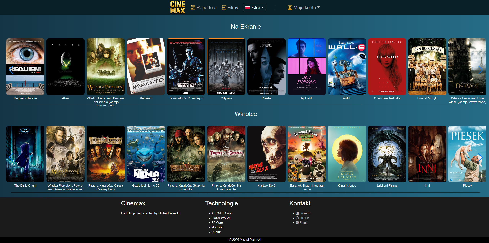
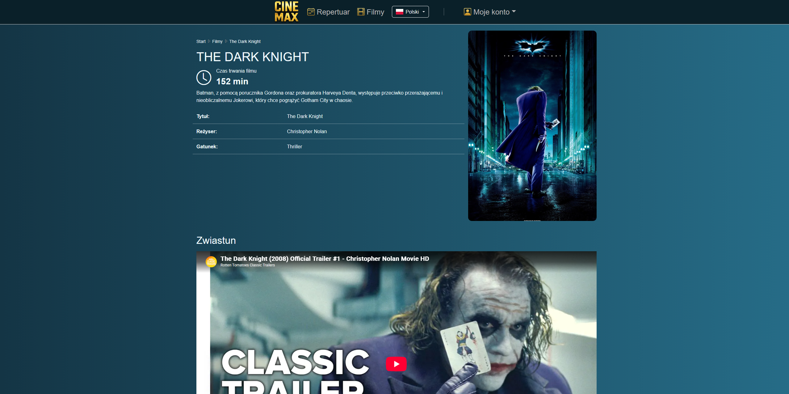
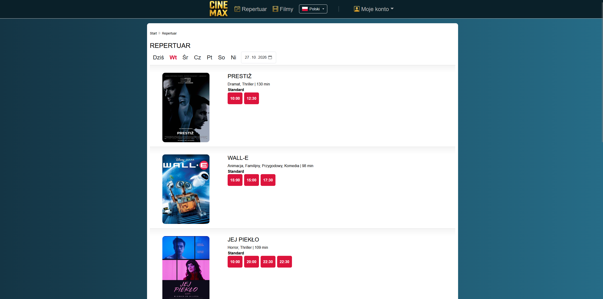
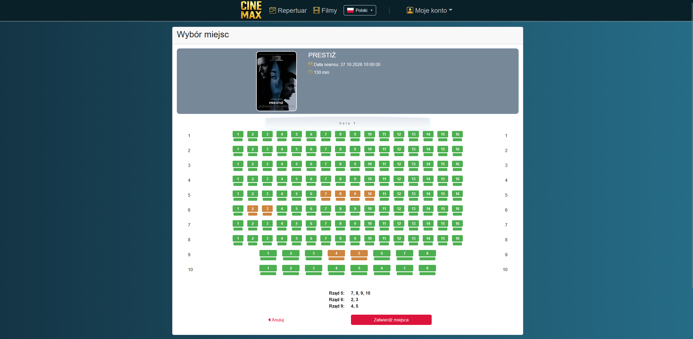
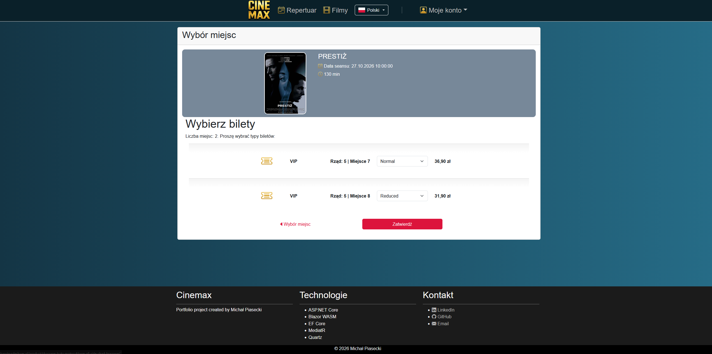
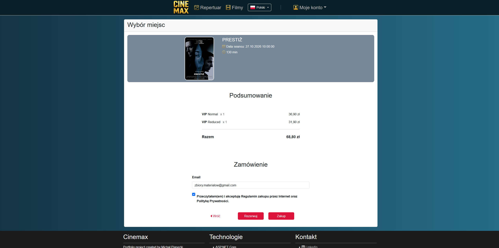
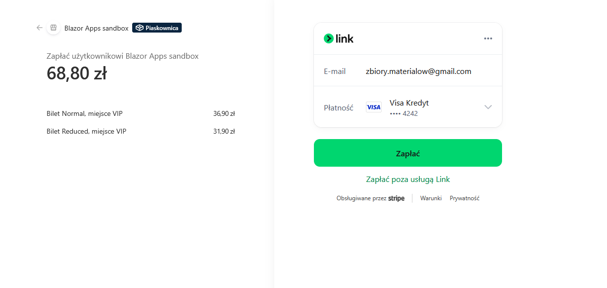
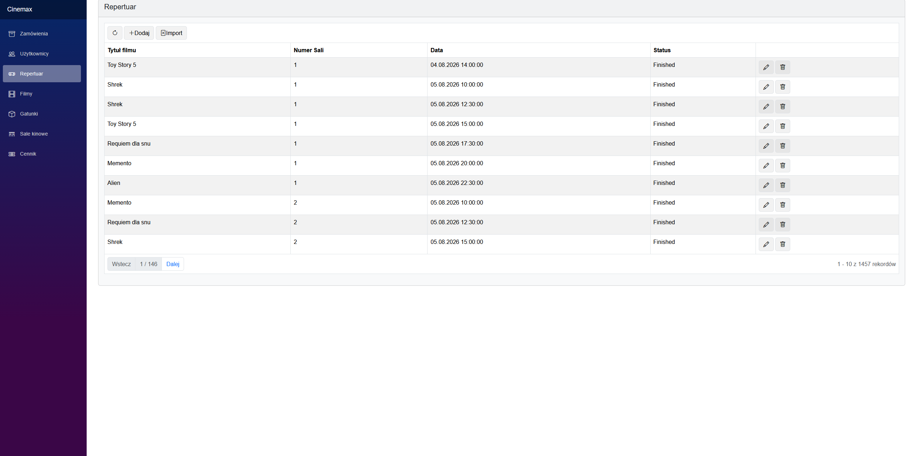
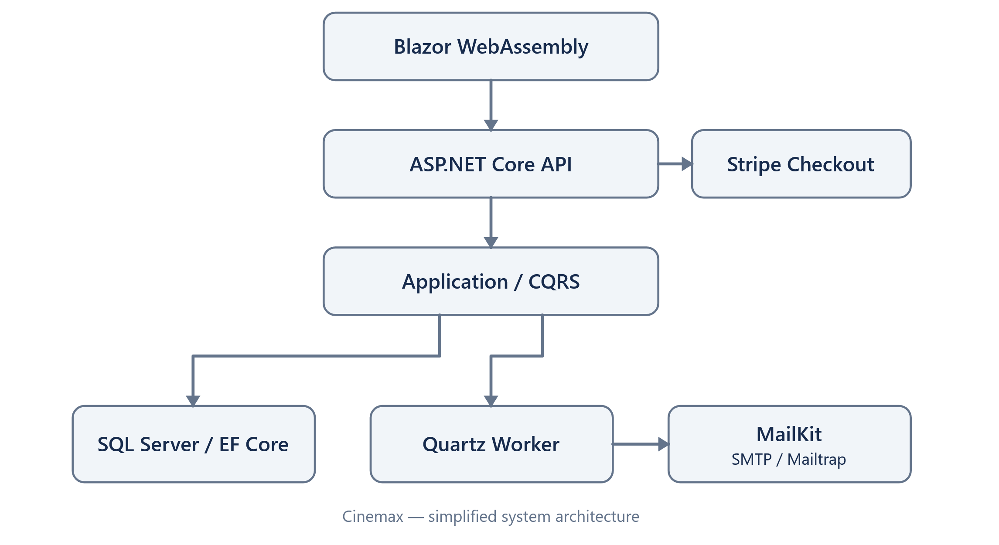

# Cinemax

**Cinemax** is a cinema ticket booking and management application built with ASP.NET Core, Blazor WebAssembly and Microsoft SQL Server.

Created as a portfolio project, it demonstrates REST API development, database design, user authentication, online payments, administrative workflows and background processing.

## Screenshots

### Home page


### Movie details && showtimes
<p align="center">
  
  
</p>

### Seat selection
<p align="center">
  
  
</p>

### Order confirmation
<p align="center">
  
  
</p>

### Administration panel


## Features

### Customer
- Browse currently showing movies and upcoming releases
- View movie details and screenings
- Select seats and ticket types
- Reserve or purchase tickets
- Pay through Stripe Checkout
- Receive ticket notifications by email
- Register and confirm an account by email
- Reset a password via email
- View order history

### Administration
- Manage movies and genres
- Manage cinema halls and seats
- Manage screenings and ticket prices
- Manage users, orders and reservations

### Employee
- Manage orders and reservations
- Manage screenings

## Tech Stack

| Area | Technologies |
| --- | --- |
| Backend | C#, .NET, ASP.NET Core Web API |
| Frontend | Blazor WebAssembly, Bootstrap |
| Database | Microsoft SQL Server, Entity Framework Core |
| Application logic | MediatR, CQRS |
| Authentication | ASP.NET Core Identity, role-based authorization |
| Payments | Stripe Checkout, webhooks |
| Email | MailKit, Mailtrap for local testing |
| Background jobs | .NET Worker Service, Quartz.NET |

## Architecture

The diagram below illustrates the main components of Cinemax and their interactions.



The solution separates domain logic, application use cases, persistence, API endpoints, UI and background work.

```text
Cinemax
├── Core
│   ├── Cinemax.Domain
│   └── Cinemax.Application
├── Infrastructure
│   ├── Cinemax.Db
│   └── Cinemax.Scheduler
├── Portal
│   ├── Cinemax.Client
│   └── Cinemax.Server
├── Worker
│   └── Cinemax.Worker
└── Shared
    └── Cinemax.Shared
```

> This is the logical solution layout. Physical directory names may differ.

| Project | Responsibility |
| --- | --- |
| `Cinemax.Domain` | Domain entities and enums |
| `Cinemax.Application` | CQRS commands, queries, handlers and abstractions |
| `Cinemax.Db` | EF Core context, configurations, repositories and migrations |
| `Cinemax.Scheduler` | Quartz.NET jobs and scheduling configuration |
| `Cinemax.Server` | REST API and server-side services |
| `Cinemax.Client` | Blazor WebAssembly frontend |
| `Cinemax.Worker` | Email processing and scheduled status updates |
| `Cinemax.Shared` | Shared DTOs and contracts |

## Technical Highlights

- **CQRS with MediatR:** Commands and queries organize application operations separately from API controllers.
- **Authentication:** ASP.NET Core Identity supports registration, email confirmation, password reset and role-based access.
- **Ticket booking:** The server validates requested seats and ticket types before processing orders.
- **Payments:** Stripe Checkout is integrated with webhook-based payment status updates rather than relying on browser redirects.
- **Email notifications:** Pending notifications are stored for asynchronous processing by a separate Worker Service.
- **Background jobs:** Quartz.NET schedules email delivery and updates to order and screening statuses.

## Requirements

- .NET SDK compatible with the solution's target framework
- Microsoft SQL Server (Developer or Express)
- Git
- Stripe account with test-mode keys
- Mailtrap Email Sandbox account for testing emails

Optional tools: Visual Studio with ASP.NET development support, SQL Server Management Studio (SSMS), Stripe CLI for local webhook testing.

## Getting Started

### 1. Clone the repository

```bash
git clone <repository-url>
cd Cinemax
```

### 2. Configure SQL Server

Install and start Microsoft SQL Server. Configure the database connection string locally, for example:

```json
{
  "ConnectionStrings": {
    "DbConnection": "Server=localhost;Database=CinemaxDb;Trusted_Connection=True;TrustServerCertificate=True;MultipleActiveResultSets=true"
  }
}
```

For SQL Server Express, the instance may be `.\SQLEXPRESS` (write `.\\SQLEXPRESS` inside JSON). The configuration key must match the one used in the application's code.

### 3. Apply database migrations

From the solution directory:

```bash
dotnet ef database update --project Infrastructure/Cinemax.Db --startup-project Portal/Cinemax.Server
```

Adjust project paths if they are nested in subdirectories. This command requires the `dotnet-ef` tool and a valid SQL Server connection.

### 4. Configure Stripe

From the `Cinemax.Server` project directory:

```bash
dotnet user-secrets set "Stripe:SecretKey" "<your-stripe-test-secret-key>" --project Portal/Cinemax.Server
dotnet user-secrets set "Stripe:WebhookSecret" "<your-webhook-signing-secret>" --project Portal/Cinemax.Server
```

Verify locally configured secrets with `dotnet user-secrets list`. The webhook signing secret is **different** from the Stripe API key. For local webhook testing, configure Stripe CLI forwarding to the actual webhook endpoint.

### 5. Configure email testing

Use Mailtrap Email Sandbox for testing. Example configuration structure:

```json
{
  "MailingSettings": {
    "Host": "sandbox.smtp.mailtrap.io",
    "Port": 587,
    "Name": "Cinemax",
    "Email": "noreply@cinemax.local",
    "Username": "<mailtrap-username>",
    "Password": "<mailtrap-password>"
  }
}
```

Store real SMTP credentials in User Secrets or environment variables, not in committed files.

### 6. Start the applications

Run both executable projects:

- `Cinemax.Server` — API and Blazor application
- `Cinemax.Worker` — scheduled jobs and email processing

The Worker may need its **own** database and SMTP configuration: User Secrets for `Cinemax.Server` are not automatically shared with `Cinemax.Worker`.

## Security

Do not commit database passwords, Stripe keys, webhook secrets or SMTP credentials. Use .NET User Secrets locally and secure configuration in deployed environments. Authorization of protected operations must be enforced by the server, not only the Blazor UI.

## Project Status

Cinemax is a portfolio project under active development, with core booking and administration workflows implemented and further usability and validation improvements planned.

## Author

**Michał Piasecki**  
Software Developer (.NET / Blazor) & QA Automation
